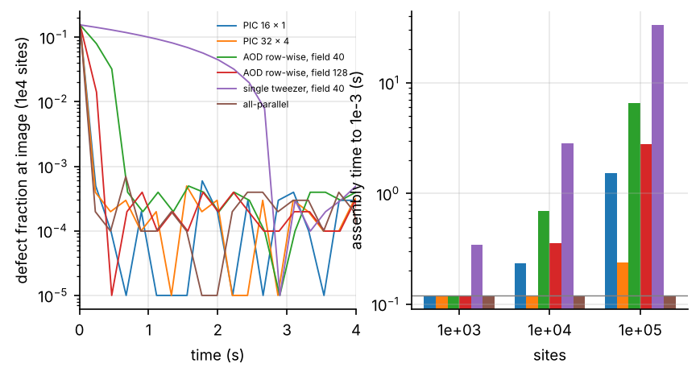

# The PIC rearrangement engine against crossed AODs, a single tweezer and an all-parallel ceiling

> Follow-up (`docs/concurrency.md`, module 29): at 10^6 sites one unit of any kind is too slow to return to new
> holes, and K independent units are needed (K = 4 for 2e-4, K = 16 for 1.5e-4 at tau 3000 s). At equal K every
> unit converges, a single moving tweezer per zone included. So concurrency does not favour the PIC either.
> Addressing is compared in `docs/addressing.md` (module 31).

Module 28. Code: `picsim/megasort.py` (`Block.mode`), `scripts/m28_aod_baseline.py`; results
`results/m28_main.json`, `results/m28_hardware.json`, `results/m28_figure.png`; tests `tests/test_megascale.py`.
Values are SIM or DERIVED, valid in the regime stated, and should be reviewed before they are quoted.

## 1. Result

We ran the same steady-state simulator, layout, loading, timing physics, losses and imaging for every method,
changing only the move constraint and the field. Three results follow.

(i) **In steady state the move constraint does not matter between 1e3 and 1e5 sites.** With a vacuum lifetime of
3000 s, every method that has assembled holds the same loss-limited floor: a time-averaged defect fraction of
1.3e-4 to 1.5e-4. This holds for both PIC blocks, crossed AODs with fields of 24 to 128 sites, a single moving
tweezer and the all-parallel ceiling. The reason is that steady-state holes appear one at a time, from vacuum and
imaging losses. Every hardware method moves on average 1.0 to 1.1 atoms per pass in the steady window, so
parallelism is not used. Only at 1e5 sites with tau = 300 s (420 refills/s) do the methods separate:
- all-parallel: 3.2e-4;
- PIC 32 x 4: 4.5e-4;
- AOD with a 128-site field: 4.7e-4;
- AOD with a 40-site field: 5.1e-4;
- PIC 16 x 1: 5.1e-4;
- single tweezer: does not keep up.

(ii) **The PIC advantage is assembly time from a random loading, and it grows with size.** At 1e5 sites with
cold steps, the 128-engine PIC block reaches 1e-3 in 0.24 s. A crossed AOD with a realistic 40-site field needs
6.6 s (2.8 s with 128 sites), one 16-chip stack 1.5 s, and a single tweezer 33 s. At 1e4 sites the times are
0.12 / 0.70 / 0.36 / 0.24 / 2.9 s. At 1e3 sites every method except the single tweezer is done by the first image
(0.12 s, the resolution of this metric). Fast steps narrow the gap: at 1e5 sites the 40-site AOD takes 2.35 s and
the PIC block 0.12 s.

(iii) **The advantage costs power and control channels.**
- **Laser power.** Provisioned for the peak number of simultaneously moving tweezers, at 1.2 mK, the PIC block
  needs 14.6 W for transport at 1e5 sites (253 tweezers x 57.7 mW). The 40-site AOD needs 0.30 W (16 x 18.7 mW),
  50 times less.
- **Fast control channels.** The PIC block needs 49,024 fast phase and amplitude channels (128 engines x 383); one
  stack needs 6,128. A crossed AOD needs 2 RF channels.
- **The ceiling.** The all-parallel ceiling assembles in one pass at every size. The SLM experiments of Sec. 6 do
  this in hardware (2,024 atoms in a constant 60 ms).

Hence the PIC engine has not been shown to be better than crossed AODs in general. It is faster at assembling
large arrays from scratch: 3 to 6 times faster at 1e4 sites and 12 to 27 times faster at 1e5 sites, against
AOD fields of 128 and 40 sites in this model. In steady-state refilling it
is equal. On power and control it is far more expensive.

| 1e5 sites, tau 3000 s, cold steps | assembly to 1e-3 | steady defect (time average) | peak moving tweezers | transport laser power at 1.2 mK | fast channels | field positions |
|---|---|---|---|---|---|---|
| PIC 32 x 4 (128 engines) | 0.24 s | 1.43e-4 | 253 | 14.6 W | 49,024 | 28 |
| PIC 16 x 1 (one stack) | 1.5 s | 1.46e-4 | 44 | 2.5 W | 6,128 | 189 |
| crossed AOD, 40-site field | 6.6 s | 1.43e-4 | 16 | 0.30 W | 2 | 88 |
| crossed AOD, 128-site field | 2.8 s | 1.47e-4 | 31 | 0.58 W | 2 | 12 |
| single tweezer, 40-site field | 33 s | (assembles in the window) | 1 | 0.019 W | 2 | 88 |
| all-parallel (ceiling) | 0.12 s | 1.27e-4 | 15,013 | not a hardware model | | 1 |

## 2. What the methods are

All methods share these settings:
- **Layout.** 4 um pitch, 85% loading, bands of 4 rows with 3 computation rows and 1 reservoir row (m23).
- **Losses.** Vacuum lifetime tau; loss per image 1e-4; images every 0.1 s (10 ms each); reservoir refresh every
  1 s.
- **Cold steps.** Ramps 200 us, lane steps 400 us, 0.3 uK and 1e-4 loss per move.
- **Fast steps.** Ramps 50 us, lane steps 100 us, 10 uK and 4e-3 loss per move.
- **Scanner.** A 300 us reposition when the field moves; no reposition when the same field is visited again.
- **Objective.** One field covering the array.

| method | per pass | field |
|---|---|---|
| PIC 16 x 1, 32 x 4 | every engine row moves any subset of its atoms along x, in order; all rows share one row shift | 16 or 32 rows; 180 um segments, 1 or 4 engines per row |
| crossed AOD, row-wise | one row tone and many column tones: the reservoir atoms of one row move to the holes of one other row, in order (column tones do not cross) | square, 24 to 128 sites |
| single tweezer | one atom, the pair with the shortest pass time | as the AOD |
| all-parallel | every known hole matched to a nearby reservoir atom, independent 2D moves, crossing allowed | whole array |

The AOD field follows from hardware.
- **Base case.** 1064 nm TeO2 deflectors are listed with 90 (3 mm aperture) and 150 (5 mm) resolvable spots and at
  least 65% diffraction efficiency per device mid-band (45035-x-6.5DEG-1.06, SOURCE). One resolution cell at NA 0.5
  is 1.06 um, so 150 spots span about 160 um, i.e. 40 sites at 4 um. We take 40 sites as the base.
- **Sensitivity.** 24 sites (90 spots) and 64 or 128 sites, as for larger devices.
- **What the model leaves out.** Moves of several rows that share one column pattern are not used, so the
  row-wise model is a lower bound on crossed-AOD throughput. Multi-tone efficiency and intermodulation are also
  not included.

Power per tweezer:
- **PIC.** 57.7 mW at the fibre per 1.2 mK tweezer (`docs/collimator.md`, Sec. 10, silvered M1).
- **AOD.** The proposal's 6.6 mW at the atoms gives 1.0 mK for its Gaussian (`docs/findings.md`), so 7.9 mW at
  1.2 mK, divided by 0.65^2 for the deflector pair: 18.7 mW (14.1 to 26.2 mW for 0.75 to 0.55 per deflector).
- **Common to both.** The objective and relay transmission is left out for both. The transport model moves at
  0.3 mK, which divides both powers by four.

## 3. Results by size

Assembly time to 1e-3 (mean over seeds; cold steps, tau 3000 s) and steady-state time-averaged defect fraction
(second half of each run):

| method | 1e3: assembly / steady | 1e4 | 1e5 |
|---|---|---|---|
| PIC 16 x 1 | 0.12 s / 1.32e-4 | 0.24 s / 1.35e-4 | 1.5 s / 1.46e-4 |
| PIC 32 x 4 | 0.12 s / 1.38e-4 | 0.12 s / 1.37e-4 | 0.24 s / 1.43e-4 |
| AOD, 40-site field | 0.12 s / 1.37e-4 | 0.70 s / 1.32e-4 | 6.6 s / 1.43e-4 |
| AOD, 128-site field | 0.12 s / 1.41e-4 | 0.36 s / 1.33e-4 | 2.8 s / 1.47e-4 |
| single tweezer, 40-site field | 0.34 s / 1.33e-4 | 2.9 s / 1.32e-4 | 33 s / - |
| all-parallel | 0.12 s / 1.30e-4 | 0.12 s / 1.25e-4 | 0.12 s / 1.27e-4 |

Seeds: 4 / 3 / 2 per case, with a spread of 1e-5 to 2e-5 at 1e3 and 1e-6 to 8e-6 at 1e4 and 1e5. At 1e3 to 1e4 sites
only 0.1 to 1 atom is lost per image, so the steady values need long runs (200 s and 60 s). The floor agrees with
the hole-lifetime model of `docs/megascale.md` (Sec. 10): eps + (T/2)/tau = 1.2e-4 for a negligible latency.

**Field size of the AOD.** At 1e4 sites assembly takes 1.03 / 0.70 / 0.58 / 0.36 s with fields of 24 / 40 / 64 /
128 sites. At 1e5 sites it takes 10.2 / 6.6 / 4.3 / 2.8 s. The steady state does not change.

**Short lifetime** (tau 300 s, about 420 refills/s at 1e5). The steady values at 1e5 are 4.5e-4 (PIC 32 x 4),
5.1e-4 (PIC 16 x 1), 5.1e-4 / 4.7e-4 (AOD 40 / 128) and 3.2e-4 (all-parallel). The single tweezer does not
assemble: it stays at 7.4e-2 after 40 s. At 1e3 and 1e4 all methods hold 3.2e-4 to 3.4e-4.

**Fast steps** (tau 3000 s). Assembly at 1e5 takes 0.12 s (PIC 32 x 4), 0.62 s (PIC 16 x 1), 2.35 / 1.12 s (AOD
40 / 128) and 9.1 s (single tweezer). The steady values are 1.34e-4 to 1.39e-4 for every method.

**Heating** per atom in the steady state is the same for every method (0.06 uK mean at 1e4 and 1e5 with cold
steps). Every refill is one move, whatever the hardware.

*Left: defect fraction just after each image, 1e4 sites, tau 3000 s, cold steps, seed 1. Right: time to the first
image with defect fraction <= 1e-3, mean over seeds, cold steps, tau 3000 s; grey line at 0.12 s, the first image
after the start and the resolution of this metric.*

## 4. Context from the literature (abstracts read 2026-11-14)

(i) **SLM, all atoms at once.** Lin et al. (arXiv:2412.14647) move all atoms at once with a fast spatial light
modulator and AI-computed holograms. They assemble defect-free arrays of up to 2,024 atoms in a constant 60 ms.

(ii) **SLM, interpolated holograms.** Knottnerus et al. (SciPost Phys. 19, 118 (2025),
doi:10.21468/SciPostPhys.19.4.118) rearrange in parallel with an SLM, interpolating positions and phases. They
update holograms every few milliseconds and succeed with probability 0.996 per cycle; the abstract gives no array
size.

(iii) **Conveyor reloading.** Chiu et al. (arXiv:2506.20660) reload 300,000 atoms per second into tweezers from
lattice conveyor belts. They initialise over 30,000 qubits per second and keep more than 3,000 atoms for over
2 hours.

(iv) **Crossed AODs in the proposal.** The proposal's crossed-AOD reference moved a median of 13 (maximum 38) atoms
per move in a 1,024-atom assembly (USER, proposal Table 1). In our model the 40-site AOD moves at most 10 to 16 per
pass, in line with it.

So the competitors of the PIC engine are the SLM for assembly and conveyor reloading for steady state, not only
crossed AODs. Our all-parallel ceiling is an idealisation of the first.

## 5. Corrections to the analysis this module answers

(i) **Actuators.** It quoted "255 per chip, 6,128 for a 16-chip stack". 255 is the D1 chip (128 ports); 6,128 is
16 x 383, the 192-port engine of `docs/megascale.md`. A 16-chip stack of D1 chips has 4,080.

(ii) **Single-tweezer throughput.** It quoted about 1,700 moves/s from a 0.6 ms pass. That pass time is the early
estimate of `docs/scaling_beyond.md`. With the timings of the transport model a cold pass takes about 2.1 ms, and
the simulated single tweezer delivers 420 to 570 refills/s. That covers 1e5 sites at tau 3000 s (125/s) but not at
300 s (420/s), and not 1e6 sites (1,242/s with the simulator's 0.11 s image cycle; 1,335/s for a 10 Hz cycle).

(iii) **Delivery.** It quoted "57 mW at the fibre for 6.6 mW at the atoms, 12% delivery". The 6.6 mW is the
proposal's Gaussian at 1.0 mK; the like-for-like figure at 1.2 mK is 7.9 mW, i.e. about 14%.

Its conclusion stands, and the simulation sharpens it: equal in steady state, faster in assembly, costlier in power
and control.

## 6. Limits

- **AOD model.** The row-wise model is a lower bound for crossed AODs, and the all-parallel case is a ceiling with
  no hardware cost.
- **Shared assumptions.** One loss model and one objective field covering the array are assumed for every method.
  The 0.3 ms field reposition is applied to the AOD and the PIC alike.
- **What the AOD power leaves out.** Multi-tone efficiency, intermodulation and the dependence of efficiency on the
  number of tones; these all favour the PIC.
- **Statistics.** 2 to 4 seeds per case.
- **Assembly resolution.** The metric is resolved only to the 0.1 s imaging period.

## Verification notes

| value | location | type | pointer |
|---|---|---|---|
| assembly times, steady defects, tweezers per pass, refills, heating | Sec. 1, 3 | SIM | results/m28_main.json (review) |
| transport power, channels, field positions | Sec. 1 | DERIVED | results/m28_hardware.json |
| 57.7 mW per 1.2 mK tweezer (PIC) | Sec. 2 | SIM | results/m27_wave.json |
| 6.6 mW per tweezer at the atoms; 1.0 mK for w0 1.04 um | Sec. 2 | USER / DERIVED | proposal draft v97; docs/findings.md |
| >= 65% per deflector, 90 / 150 resolvable spots at 1064 nm | Sec. 2 | SOURCE | sintec.sg/ao/497.html (G&H/distributor listing, read 2026-11-14) |
| 40-site field from 150 spots x 1.06 um | Sec. 2 | DERIVED | |
| 383 / 255 fast actuators per engine | Sec. 1, 5 | SIM | docs/megascale.md Sec. 4; docs/fpr_design.md |
| median 13, max 38 per move | Sec. 4 | USER | proposal Table 1, its ref. [17] |
| Lin et al.: 2,024 atoms, 60 ms | Sec. 4 | SOURCE | arXiv:2412.14647, abstract read 2026-11-14 |
| Chiu et al.: 300,000 atoms/s, 30,000 qubits/s, > 3,000 atoms > 2 h | Sec. 4 | SOURCE | arXiv:2506.20660, abstract read 2026-11-14 |
| Knottnerus et al.: holograms every few ms, 0.996 per cycle | Sec. 4 | SOURCE | doi:10.21468/SciPostPhys.19.4.118, abstract read 2026-11-14 |
| loss model, layout, timings | Sec. 2 | CHOICE / SIM | m23 (see results/m28_main.json inputs) |

Open placeholders: [VALUE?] AOD multi-tone efficiency and intermodulation at 10 to 30 tones; [VALUE?] AOD field
scanner settling time (taken equal to the PIC row-select scanner).
