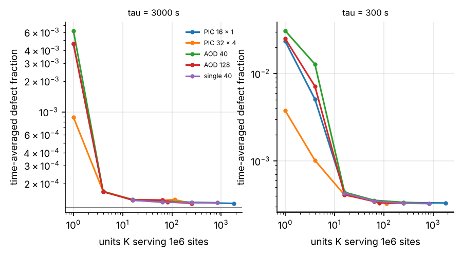

# Concurrent repair at 10^6 sites: many units against one

Module 29. Code: `scripts/m29_concurrency.py` (reusing `picsim/megasort.py` and the settings of module 28);
results `results/m29_capacity.json`, `results/m29_ladder.json`, `results/m29_hardware.json`,
`results/m29_figure.png`. Values are SIM or DERIVED, valid in the regime stated, and should be reviewed before they
are quoted.

## 1. Result

The proposition tested comes from the analysis that followed module 28. It holds that steady-state repair at 10^6
sites is limited per stream, so the winning quantity is the number of engines working at once, and that chips
replicate where AOD pairs do not. In our model the first half holds and the second does not.

(i) **Concurrency is needed at 10^6 sites, by every method.** One unit scanning the whole array leaves the array
at a time-averaged defect fraction of 8.9e-4 (PIC 32 x 4, 128 engines) to 6.2e-3 (crossed AOD with a 40-site field)
with tau = 3000 s. Four units bring every method to 1.66e-4 to 1.68e-4, and sixteen to 1.37e-4 to 1.39e-4, close to
the floor eps + T/(2 tau) = 1.17e-4.

(ii) **Concurrency does not favour the PIC.** At equal K the units converge. Every unit needs K = 4 for 2e-4 and
K = 16 for 1.5e-4, and with K = 16 even a single moving tweezer per zone holds 1.37e-4. The PIC units then cost far
more. Fast control channels are the fixed cost; laser power is given provisioned and in steady state:

| K | PIC 32 x 4 | PIC 16 x 1 | AOD, 128-site field | AOD, 40-site field | single tweezer |
|---|---|---|---|---|---|
| 4 (<= 2e-4): channels | 196,096 | 24,512 | 8 | 8 | not simulated |
| power provisioned / steady | 71.5 W / 0.25 W | 40.6 W / 0.23 W | 9.0 W / 0.076 W | 3.0 W / 0.075 W | |
| 16 (<= 1.5e-4): channels | 784,384 | 98,048 | 32 | 32 | 32 |
| power provisioned / steady | 286 W / 0.99 W | 162 W / 0.94 W | 36 W / 0.30 W | 12 W / 0.30 W | 0.30 W / 0.30 W |

K counts whole units, ceil(10^6 / sites per zone). Transport laser power is at 1.2 mK; divide by 4 for the 0.3 mK
moving depth of the transport model.
- **Provisioned power** covers each unit at its peak simultaneous tweezers when busy (assembly or saturation, up to
  310 for PIC 32 x 4).
- **Steady-state power** is K x the mean tweezers per pass in the steady window, about 1.0 to 1.1 per unit.
(Corrected: an earlier version used the non-integer 10^6 / sites per zone, which gave slightly low totals, e.g.
195,705 instead of 196,096, and showed only the provisioned power.)

(iii) **Throughput is not the limit.** At saturation, the capacity per unit with cold steps is:
- PIC 32 x 4: about 76,000 moves/s;
- PIC 16 x 1 and the 128-site AOD: about 37,000 to 40,000;
- 40-site AOD: about 20,000;
- single tweezer: 570.
The demand at 10^6 sites is 1,242/s at tau 3000 s and 4,242/s at 300 s, with the simulator's image cycle
T_img + t_img = 0.11 s. The measured refill rates match: 1,225/s and 4,247/s for PIC 32 x 4 at K = 1. (Corrected: an
earlier version used a 0.1 s cycle, 1,335/s and 4,330/s.) What limits one unit on a large array is
latency: the time its field needs to come back to a new hole after each image. Splitting the array shortens that
time for every method alike.

The analysis's starting figure, 420 to 570 refills/s "per stream", was measured for the single tweezer only. For
the other units, module 28 measured the refill rate equal to the demand, not their capacity.

By the decision rule set before the runs, the PIC unit needs as many units (beam paths into the objective) as AOD
pairs for the same target, with more power and channels. Concurrency therefore does not make the case for PIC
transport. The case for it rests on assembly speed from a random loading (module 28).

## 2. Method

Zones are independent, since each holds its own reservoir rows and its own unit. K units on 10^6 sites are
therefore one zone of 10^6 / K computation sites, simulated with the units and settings of module 28. Those are:
- 85% loading, bands of 4 rows (3 computation, 1 reservoir), 4 um pitch;
- loss per image 1e-4, images every 0.1 s;
- cold steps (200 us ramps, 400 us lane steps);
- reservoir refresh every 1 s;
- 300 us field reposition, none when the same field is revisited.

| unit | per pass | field without scanning (fixed limit) |
|---|---|---|
| PIC 16 x 1 | 16 engine rows, independent in-order x moves, shared row shift | 16 x 46 sites (K = 1,812 at 10^6) |
| PIC 32 x 4 | 32 rows x 4 engines | 32 x 368 sites (K = 113) |
| crossed AOD | one row tone, many column tones (lower bound on AOD throughput) | 40 x 40 or 128 x 128 sites (K = 833 or 81) |
| single tweezer | one atom | 40 x 40 sites (K = 833) |

Each zone runs from an assembled start, with every computation site filled at t = 0, so the steady state is
measured without the assembly transient. The window is the last two thirds of each run, long enough for about 600
losses per run, with 2 to 6 seeds.

**Capacity.** Each unit runs on 10^4 and 10^5-site zones with a loss of 0.1 per image (1 refill/s per site, far
above capacity), with the reservoir refreshed every 0.1 s so supply does not bind. Moves per second in the window
are the capacity. Refills are 1 to 8% lower, because some reservoir atoms seen in the image are lost before they are
moved.

**Hardware.**
- Laser power per tweezer is 57.7 mW for the PIC (fibre input, m27) and 18.7 mW for the AOD (module 28).
- Provisioned power: K x peak simultaneous tweezers of a busy unit (capacity runs) x power per tweezer.
- Steady-state power: K x mean tweezers per pass in the ladder's steady window x power per tweezer.
- Channels: 383 per PIC engine (192-port engine) and 2 per AOD pair.

## 3. Results

**Steady state vs K** (time-averaged defect fraction at 10^6 sites; mean over seeds, spread 1e-6 to 2e-5):

| K (zone) | PIC 32 x 4 | PIC 16 x 1 | AOD 128 | AOD 40 | single |
|---|---|---|---|---|---|
| tau 3000 s: 1 (whole array) | 8.9e-4 | 4.6e-3 | 4.6e-3 | 6.2e-3 | - |
| 4 | 1.68e-4 | 1.67e-4 | 1.66e-4 | 1.67e-4 | - |
| 16 | 1.39e-4 | 1.39e-4 | 1.38e-4 | 1.37e-4 | 1.37e-4 |
| 64 | 1.37e-4 | 1.37e-4 | 1.38e-4 | 1.34e-4 | 1.31e-4 |
| 252 | 1.27e-4 | 1.31e-4 | 1.28e-4 | 1.30e-4 | 1.30e-4 |
| fixed field | 1.39e-4 (K 113) | 1.28e-4 (K 1,812) | 1.32e-4 (K 81) | 1.29e-4 (K 833) | 1.29e-4 (K 833) |
| tau 300 s: 1 | 3.8e-3 | 2.3e-2 | 2.5e-2 | 3.1e-2 | - |
| 4 | 1.0e-3 | 5.1e-3 | 7.1e-3 | 1.3e-2 | - |
| 16 | 4.1e-4 | 4.4e-4 | 4.1e-4 | 4.4e-4 | 4.3e-4 |
| 64 | 3.5e-4 | 3.5e-4 | 3.4e-4 | 3.6e-4 | 3.5e-4 |
| fixed field | 3.3e-4 | 3.3e-4 | 3.3e-4 | 3.3e-4 | 3.3e-4 |

The PIC 32 x 4 block is clearly the best single unit with cold steps, at K = 1 and 4 and especially with
tau 300 s. It is itself 128 engines, however. Once the array is split among 16 or more units, the unit no longer
matters.

**Fast steps** (50 us ramps, 10 uK and 4e-3 loss per move; tau 3000 s; three seeds, mean +/- spread;
`results/m29_ladder_fast.json`). `docs/megascale.md` finds one 128-engine block near 2e-4 at 10^6 sites at this
operating point. The 128-site AOD pair reaches the same level:

| K | PIC 32 x 4 | PIC 16 x 1 | AOD 128 | AOD 40 |
|---|---|---|---|---|
| 1 | 1.91e-4 +/- 0.03e-4 | 4.03e-4 +/- 0.09e-4 | 1.84e-4 +/- 0.01e-4 | 3.19e-4 +/- 0.14e-4 |
| 4 | 1.48e-4 +/- 0.02e-4 | 1.50e-4 +/- 0.02e-4 | 1.45e-4 +/- 0.04e-4 | 1.48e-4 +/- 0.03e-4 |

So with fast steps one PIC 32 x 4 block and one crossed AOD with a 128-site field are equal to within 4%; the AOD is
marginally lower. With four units every type is within the seed spread of the others.

**Assembly from a random loading** (zones of 6.25e4 sites and smaller, i.e. K >= 16): PIC units are done by the
first image (0.12 s) up to 1.56e4-site zones. At 6.25e4 sites the times are:
- PIC: 0.23 s (32 x 4), 1.0 s (16 x 1);
- AOD: 1.5 s (128-site field), 4.2 s (40-site field);
- single tweezer: 19 s.
This matches module 28: assembly is where the PIC is faster.

**Capacity** (moves/s at saturation; 10^5-site zone, cold / fast steps):

| unit | cold | fast | peak tweezers when busy |
|---|---|---|---|
| PIC 32 x 4 | 76,400 | 88,700 | 310 |
| PIC 16 x 1 | 36,600 | 62,500 | 176 |
| AOD, 128-site field | 39,900 | 61,800 | 120 |
| AOD, 40-site field | 19,700 | 43,200 | 40 |
| single tweezer | 570 | 1,810 | 1 |

*Time-averaged steady-state defect fraction at 10^6 sites against the number of independent units K (zones of
10^6/K sites), cold steps, assembled start; left tau 3000 s, right 300 s. Grey line: eps + T/(2 tau), the floor for
zero latency.*

## 4. Limits

- **Shared field.** K units must share one objective field. This is reported, not modelled. For the PIC, engines
  tile at 3.0 mm pitch with lenslets (module 24); for AOD pairs no tiling optics is designed or claimed.
- **Loss model.** One loss model and one imaging cadence apply throughout. Zone boundaries are taken as hard; in
  practice, sites near a boundary could be served from either side.
- **AOD model.** The crossed-AOD model is the row-wise lower bound of module 28.
- **Statistics.** 2 to 6 seeds per case, about 600 losses per run.

## Verification notes

| value | location | type | pointer |
|---|---|---|---|
| defect fractions vs K, assembly times | Sec. 1, 3 | SIM | results/m29_ladder.json (review) |
| fast-step K = 1 and 4 at 10^6 sites | Sec. 3 | SIM | results/m29_ladder_fast.json (three seeds; review) |
| capacity per unit, peak tweezers | Sec. 1, 3 | SIM | results/m29_capacity.json (review) |
| power and channels vs K, smallest K | Sec. 1 | DERIVED | results/m29_hardware.json |
| floor eps + T/(2 tau) | Sec. 1 | DERIVED | docs/megascale.md Sec. 10 |
| demand 1,242/s (tau 3000 s), 4,242/s (300 s) | Sec. 1 | DERIVED | N (1/tau + eps/(T_img + t_img)), cycle 0.11 s |
| units, timings, losses, per-tweezer powers | Sec. 2 | SIM / CHOICE / SOURCE | docs/aod_comparison.md |
